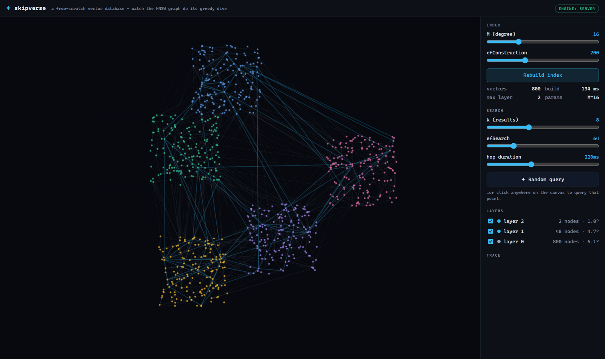

# skipverse

A TypeScript vector search engine with an HNSW index, WAL-backed storage and a browser visualization of search traversal.

**[Live demo →](https://qiyuhuating.github.io/skipverse/)** · [API reference](#api-reference)

Node.js 20+ · ESM · Zero runtime dependencies



The browser demo uses the same HnswIndex core as the Node.js engine. Watch the search descend through graph layers and select the nearest results.

## Features

- HNSW search with cosine, Euclidean and dot-product metrics.
- Filtered search, soft deletion and compaction.
- SQ8, SQ4 and product quantization with one-shot calibration.
- CRC-framed WAL, snapshot checkpoints and deterministic replay.
- HTTP API, CLI and worker-thread read snapshots.

## Run from source

Build the repository locally; the commands below do not require a published npm package.

```sh
git clone https://github.com/qiyuhuating/skipverse.git
cd skipverse
npm ci
npm run build
node dist/node/cli.js serve --port 8787 --data ./example-data --dim 3 --metric cosine
```

Insert and search:

```sh
curl -X POST localhost:8787/vectors -H 'content-type: application/json' \
  -d '{"vectors":[{"id":"a","vec":[0.1,0.2,0.3]}]}'
curl -X POST localhost:8787/search -H 'content-type: application/json' \
  -d '{"vec":[0.1,0.2,0.3],"k":1,"ef":64,"trace":true}'
```

Stop the server before starting the local browser demo:

```sh
npm run demo:build
npm run serve
```

Open http://localhost:8787 .

## Embed the built engine

From the repository root:

```js
import { HnswIndex } from "./dist/node/index.js";

const index = new HnswIndex({ dim: 3, metric: "cosine" });
index.add("doc-1", [0.1, 0.2, 0.3]);
const hits = index.search([0.1, 0.2, 0.3], 1, { ef: 64 });
```

Persistent storage:

```js
import { VectorStore } from "./dist/node/index.js";

const store = VectorStore.open({
  dataDir: "./data",
  dim: 3,
  metric: "cosine",
  fsync: true
});
store.upsert("doc-1", [0.1, 0.2, 0.3]);
const hits = store.search([0.1, 0.2, 0.3], 1);
store.close();
```

## Test and benchmark

```sh
npm run typecheck
npm test
npm run bench
npm run bench:ci
```

The benchmark uses seeded data and reports recall, throughput and nodes visited.
Results depend on workload, search budget and quantization; measure with representative vectors before choosing a configuration.

## Limits

A store supports one writer. Worker-thread readers hold explicit snapshots; call `refresh()` after writes.
Deletes leave traversal anchors until compaction. Quantization trades precision for storage and uses frozen calibration ranges.

WAL recovery scans the valid CRC-framed prefix and truncates torn tails. Enable `fsync: true` when writes must be synced to disk; the default append path does not sync each write.

## API reference

### HnswIndex (embeddable, isomorphic)

| signature | what it does | notes |
|:--|:--|:--|
| `new HnswIndex({ dim, metric?, M?, efConstruction?, seed?, quantization?, pqSubspaces?, extendCandidates? })` | create an index | `metric`: cosine (default) / euclidean / dot · `M` 16 · `efConstruction` 200 · `seed` pins layer assignment · `quantization`: none / sq8 / sq4 / pq |
| `add(id, vec)` | insert or replace | replace soft-deletes the old vector · vec: `number[]` / `Float32Array` |
| `remove(id)` | soft delete | stays as traversal anchor, filtered from results · returns `false` if absent |
| `search(q, k?, { ef?, filter? })` | k nearest | `ef` defaults to `max(k, 16)` · `filter(id)`: excluded nodes are traversed, never returned |
| `searchWithTrace(q, k?, opts?)` | search + traversal | returns `{ results, trace }` — the demo animates `trace.layers` |
| `vector(id)` | stored vector | dequantized after calibration · null when absent/deleted |
| `adjacency(id)` | per-level neighbor ids | for visualization / introspection |
| `compacted()` | rebuild without tombstones | deterministic · calibration carries over |
| `calibrate()` | freeze ranges, rewrite codes | one-shot calibration |
| `serialize()` / `HnswIndex.deserialize(data)` | binary round-trip | format v2 · v1 indexes still load |
| `stats()` | counts, per-level degree stats | |
| `size` · `deletedCount` · `isCalibrated` · `bytesPerVector` | live metrics | |

### SearchPool (concurrent reads, Node)

| signature | what it does | notes |
|:--|:--|:--|
| `new SearchPool({ store, workers? })` | N workers hold read-only snapshots | default: `cpus−1` capped at 4 |
| `searchAsync(vec, k?, ef?)` | search off the main thread | promise per request, round-robin dispatch |
| `refresh()` | broadcast a fresh snapshot | required after writes — snapshots are explicit |
| `close()` | drain and exit all workers | in-flight searches settle first |

Single file, worker re-enters the module itself, zero dependencies. Results are identical to the synchronous path.

### VectorStore (durable, Node)

| signature | what it does | notes |
|:--|:--|:--|
| `VectorStore.open({ dataDir, dim, metric?, M?, efConstruction?, seed?, quantization?, fsync?, checkpointEvery? })` | open or create | validates meta.json on reopen · `fsync: true` = real power-loss durability |
| `upsert(id, vec)` / `upsertBatch(entries)` | writes | batch = one WAL syscall (one fsync per batch) |
| `remove(id)` · `get(id)` | tombstone / read back | `get` is dequantized post-calibration |
| `search(q, k?, opts?)` / `searchWithTrace(...)` | queries | delegates to the index |
| `calibrate()` | calibrate + rotate snapshot | |
| `compact()` | rebuild + snapshot rotation | returns `{ before, after }` |
| `checkpoint()` | snapshot + WAL truncate | automatic every `checkpointEvery` ops (default 4096) |
| `close(checkpoint?)` | release lock + fd | |
| `info()` | stats + WAL bytes | |

Single-writer: a store held by a live process refuses a second `open`; stale locks from dead processes are cleared automatically.

### HTTP API

| route | body | response |
|:--|:--|:--|
| `POST /vectors` | `{ vectors: [{id, vec}] }` | `{ upserted, count }` |
| `GET /vectors/:id` | — | `{ id, vec }` · 404 if absent |
| `DELETE /vectors/:id` | — | `{ removed }` |
| `POST /search` | `{ vec, k?, ef?, trace? }` | `{ results, tookMs }` · + `trace` when asked |
| `GET /stats` | — | index + WAL stats |
| `POST /checkpoint` | — | `{ ok }` |
| `GET /healthz` | — | `{ ok, count }` |

Every response carries an `x-response-time` header.

### CLI

| command | flags | purpose |
|:--|:--|:--|
| `skipverse serve` | `--port --data --dim --metric --M --ef-construction --quantization` | HTTP + demo |
| `skipverse import` | `--file vectors.jsonl` + store flags | bulk load (500/batch) |
| `skipverse calibrate` | store flags | freeze ranges + rewrite codes |

## License

[MIT](LICENSE) © 2026 qiyuhuating
